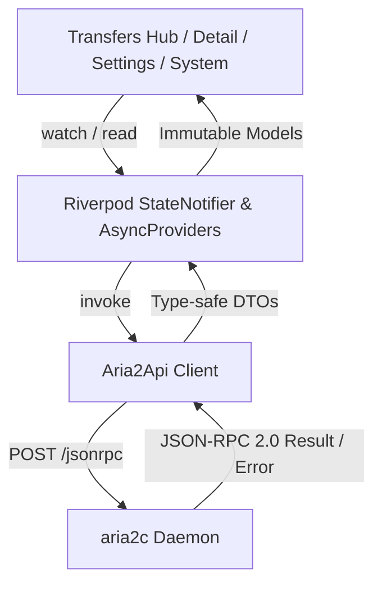

# aria2 service (`service_aria2`)

`service_aria2` is Atrium's native client for [aria2](https://aria2.github.io/), the high-speed multi-protocol and multi-source command-line download utility.

## Architecture & Protocol

aria2 speaks JSON-RPC 2.0 over HTTP `POST /jsonrpc`. Unlike REST APIs, it uses RPC method envelopes with positional arguments.



### 1. RPC Authentication
The daemon's RPC secret (`--rpc-secret`) is passed as `token:<secret>` as the very first positional parameter of every JSON-RPC call.
- The secret is never sent in HTTP query parameters or request headers, preventing inadvertent exposure in reverse proxy access logs.
- If a daemon runs without `--rpc-secret`, the parameter is omitted automatically.
- RPC authentication failures return HTTP 400 with an error object (`code: 1, message: "Unauthorized"`). The health probe validates the JSON-RPC payload rather than HTTP status code alone.

### 2. High-Efficiency Atomic Polling
To minimize network overhead and eliminate race conditions across multiple lists, polling is batched into a single `system.multicall` request:
1. `aria2.tellActive`
2. `aria2.tellWaiting` (offset: 0, num: 1000)
3. `aria2.tellStopped` (offset: 0, num: 1000)
4. `aria2.getGlobalStat`
5. `aria2.getVersion`
6. `aria2.getSessionInfo`

All download states and aggregate metrics update in one unified frame without flickering or mismatched totals.

### 3. Numerical Resilience
aria2's JSON-RPC responses serialize large 64-bit integers (file sizes, completed lengths, download speeds) as strings. The domain models (`Aria2Download`, `Aria2File`, `Aria2GlobalStat`, `Aria2Peer`) use resilient JSON converters that transparently parse both strings and native numbers.

## Features & UX Design

The user interface follows a modern Sonarr/Radarr-inspired workflow designed specifically for mobile ergonomics:

- **Telemetry Hero Header**: Live aggregate download/upload speeds with animated direction glyphs, alongside active, waiting, and stopped transfer counts.
- **Dynamic Filter Chips**: Instant filtering by `All`, `Active`, `Waiting`, `Paused`, `Complete`, and `Error` with dynamic item count badges.
- **Live Search & Multi-Field Sorting**:
  - Filter downloads in real-time across download name, GID, save path, and BitTorrent info-hash.
  - Multi-field sorting by Name, Progress, Size, Transfer Speed, or ETA with ascending/descending direction toggle.
- **Batch Selection**:
  - Long-press or app bar toggle to activate multi-selection mode.
  - Indeterminate selection status, Select All / Deselect All.
  - Batch operations: Batch Pause (`aria2.pause`), Batch Resume (`aria2.unpause`), and Batch Remove (`aria2.remove` / `aria2.removeDownloadResult`).
- **Transfer Cards**:
  - Protocol badges (BitTorrent, HTTP, FTP, Metalink).
  - Status badges with contextual colors from `Theme.of(context).colorScheme`.
  - Progress bar, remaining ETA, completed/total size, and peer/seeder counts.
  - Quick action menu for pause, resume, speed limits, mirror inspection, queue reordering, and removal.
- **Deep Download Inspector (`Aria2DownloadDetailScreen`)**:
  - **Overview**: GID, save directory, piece size, piece count, info-hash, error codes, and live transfer rates.
  - **Files**: Interactive file tree with individual file progress and sizes.
  - **Sources & Mirrors**: Live connection states, active mirror URIs, dynamic mirror injection dialog (`aria2.changeUri`), and mirror removal.
  - **BitTorrent Peers**: Real-time peer list (`aria2.getPeers`) detailing client software, IP/port, connection flags, choking/seeding status, and per-peer transfer speeds.
  - **Per-Download Speed Limits**: Live rate limiting override (`aria2.changeOption` for `max-download-limit` and `max-upload-limit`).
- **Global Settings Tab**:
  - Comprehensive daemon options editor structured into Bandwidth, Concurrency, Storage, and BitTorrent.
  - Edit global download/upload limits, max concurrent downloads, split connections per server, min split size, disk cache, file preallocation, DHT, and peer exchange with live validation.
- **System Diagnostics Tab**:
  - Session ID, process uptime, active feature flags (Async DNS, BitTorrent, HTTPS, Metalink, etc.).
  - Graceful daemon shutdown and force-shutdown triggers with confirmation dialogs.
- **Add Download Sheet**:
  - Supports HTTP/HTTPS URLs, FTP, BitTorrent magnet links, and local `.torrent` file selection.
  - Optional custom download directory override, request headers, and connection split configuration.

## Dynamic Theming & Material 3 Compliance

This package strictly conforms to Atrium's dynamic Material 3 design system:
- **Zero Hardcoded Colors**: No instances of `Colors.*` or raw `Color(0x...)` constants exist in the UI layer.
- All colors resolve dynamically from `Theme.of(context).colorScheme`:
  - `cs.primary` / `cs.onPrimaryContainer`: Primary accents, active transfers, and progress bars.
  - `cs.tertiary` / `cs.onTertiaryContainer`: Upload telemetry and BitTorrent seeding indicators.
  - `cs.error` / `cs.onErrorContainer`: Failed downloads, error badges, and destructive actions.
  - `cs.surfaceContainerLow` / `cs.surfaceContainerHighest`: Card containers, search bars, and bottom sheets.
  - `cs.outlineVariant` / `cs.onSurfaceVariant`: Secondary labels, dividers, and inactive state badges.

## Verification & Testing

### Unit & Widget Tests
Run the test suite from the repository root:
```bash
flutter test services/service_aria2/test/
```

### Static Analysis
```bash
flutter analyze services/service_aria2
```

### Live Integration Tests
The package includes live integration tests that verify RPC interactions against an actual running `aria2c` daemon:
```bash
ARIA2_URL=http://127.0.0.1:6800/jsonrpc ARIA2_SECRET=your_secret flutter test services/service_aria2/test/live_aria2_test.dart
```
